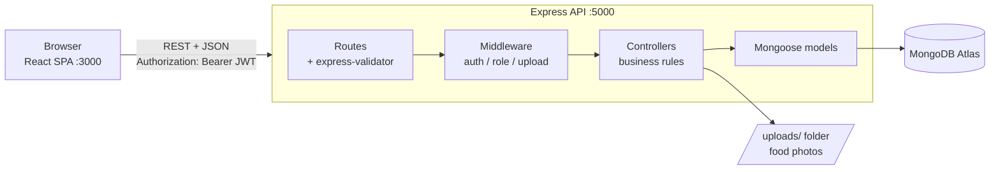

# Food2Go

Food2Go connects **food donors** (households, restaurants, events with surplus food) with **NGOs** that distribute it to people in need.

**Live demo:** https://food2go.vercel.app — log in with the [demo accounts](#3-demo-accounts-optional) (password `demo1234`). The API runs on Render's free tier, so the first request after a while can take up to a minute while it wakes up.

- **Donors** pick an NGO, donate food (with an optional photo) and track the donation's status. They can also browse NGOs' food requests and fulfil **all or part** of one.
- **NGOs** see only the donations made to them, accept them and confirm what was received. They post food requests and track each one's progress (received / on the way / still needed) along with every donor's contribution.

> **v2** is a rewrite of the original AWS version (Cognito + API Gateway + Lambda + DynamoDB + S3) as a self-hosted **MERN** application (MongoDB, Express, React, Node).

---

## Architecture



**Request flow:** route → input validation → JWT check (`protect`) → role check (`requireRole`) → controller → Mongoose model → MongoDB. Every error goes through one `errorHandler`, so the API always responds with `{ "message": "..." }` and the right status code.

### AWS → MERN mapping

| Concern | v1 (AWS) | v2 (this repo) |
|---|---|---|
| Sign-up / login | Amazon Cognito + Amplify | `bcryptjs` password hashing + **JWT** (`/api/auth`) |
| User profile attrs (`custom:ngoName`, `custom:role`) | Cognito custom attributes | `role` + `ngo` fields on the `User` model |
| REST endpoints | API Gateway + Lambda | **Express** routes and controllers |
| Database | DynamoDB | **MongoDB Atlas** via Mongoose |
| Food photos | S3 | `multer` → local `uploads/` folder, served statically |
| Logs | CloudWatch | `morgan` request logs |
| Donation status | React state only (lost on refresh) | Stored in DB, with enforced state transitions |

---

## Project structure

```
backend/
  src/
    app.js                 Express app (middleware + routes); exported for tests
    server.js              Connects to MongoDB, seeds NGOs, starts the server
    config/                env.js (all config), db.js (Mongo connection)
    models/                User, Ngo, Donation, FoodRequest
    middleware/            auth (JWT + roles), validate, upload (multer), errorHandler
    controllers/           auth, ngo, donation, foodRequest
    routes/                one router per resource
    seed/ngos.js           initial NGO list
    utils/                 ApiError, asyncHandler
  tests/                   Jest + Supertest API tests (in-memory MongoDB)
frontend/
  src/
    api.js                 fetch wrapper: base URL, JWT storage, error handling
    components/ProtectedRoute.jsx   role-based route guard
    pages/                 Home, Login/Signup (donor & NGO), dashboards, confirmation
```

---

## Running locally

**Prerequisites:** Node.js 18+ (developed on Node 22).

### 1. Backend

```bash
cd backend
npm install
copy .env.example .env      # macOS/Linux: cp .env.example .env
npm run dev                 # http://localhost:5000
```

In `.env`, set `MONGO_URI` to your MongoDB Atlas connection string and `JWT_SECRET` to any long random string.

> If `MONGO_URI` is left empty, the server starts with a temporary **in-memory MongoDB**, which is handy for a quick demo without internet. Data is lost on restart.

**MongoDB Atlas setup (free tier):** create a cluster → *Database Access*: add a user → *Network Access*: add your IP (or `0.0.0.0/0` for a demo) → *Connect → Drivers*: copy the `mongodb+srv://...` string. Add `/food2go` before the `?` so data goes to a `food2go` database.

### 2. Frontend

```bash
cd frontend
npm install
npm start                   # http://localhost:3000
```

The frontend calls `http://localhost:5000/api` by default. To change it, set `REACT_APP_API_URL`.

### 3. Demo accounts (optional)

```bash
cd backend
npm run seed:demo
```

This creates one donor and one login per NGO (password `demo1234` for all). Running it again leaves existing accounts alone.

| Role | Email |
|---|---|
| Donor | `donor@food2go.test` |
| CRY | `cry@food2go.test` |
| Goonj | `goonj@food2go.test` |
| Akshaya Patra | `akshayapatra@food2go.test` |
| Helping Hands | `helpinghands@food2go.test` |
| Feeding India | `feedingindia@food2go.test` |

### 4. Tests

```bash
cd backend
npm test
```

29 API tests cover signup/login, auth and role guards, input validation, photo upload rules, NGO-scoped data access, the donation status workflow, and partial fulfilment of food requests (over-pledging, partial receipt, completion). They run against an in-memory MongoDB, so no Atlas connection is needed.

---

## API reference

Base URL: `http://localhost:5000/api`. Protected routes need the header `Authorization: Bearer <token>`, using the `token` returned by signup or login.

| Method | Endpoint | Auth | Body / Query | Description |
|---|---|---|---|---|
| GET | `/health` | — | — | Health check |
| POST | `/auth/signup` | — | `{ name, email, password, role: "donor" \| "ngo", ngoId* }` | Create account, returns `{ token, user }`. `ngoId` is required when role is `ngo` |
| POST | `/auth/login` | — | `{ email, password, role? }` | Returns `{ token, user }` |
| GET | `/auth/me` | any | — | Current user |
| GET | `/ngos` | — | `?search=pune` | List NGOs (search by name or city) |
| POST | `/donations` | donor | **form-data**: `ngoId, foodName, quantity, building, street, city, state?, mapLink?, photo?` (file) | Create donation (status `Available`) |
| GET | `/donations` | any | `?status=Pending` | Donor: own donations · NGO: donations to their NGO |
| PATCH | `/donations/:id/status` | ngo | `{ status, receivedAmount? }` | Allowed: `Available→Pending`, `Pending→Completed`, `Pending→Available`. For request donations, `receivedAmount` (≤ pledged, defaults to pledged) is added to the request |
| POST | `/food-requests` | ngo | `{ foodNeeded, quantityNeeded, unit, location, notes? }` | Post a food request |
| GET | `/food-requests` | any | — | Donor: all requests · NGO: own requests. Each includes `quantityReceived`, `quantityPledged`, `quantityRemaining`, `status` |
| POST | `/food-requests/:id/donations` | donor | **form-data**: `amount, building, street, city, state?, mapLink?, photo?` | Fulfil all or part of a request. `amount` must be ≤ what is still needed |

**Sample bodies**

```json
// POST /auth/signup (donor)
{ "name": "Riya Shah", "email": "riya@example.com", "password": "secret123", "role": "donor" }

// POST /auth/signup (NGO): get ngoId from GET /ngos
{ "name": "Arjun Mehta", "email": "arjun@example.com", "password": "secret123", "role": "ngo", "ngoId": "<_id>" }

// PATCH /donations/:id/status
{ "status": "Pending" }

// POST /food-requests
{ "foodNeeded": "Lunch boxes", "quantityNeeded": 40, "unit": "boxes", "location": "Kothrud, Pune", "notes": "Before 1 pm" }

// POST /food-requests/:id/donations  (form-data in Postman: Body → form-data)
amount=25  building=Sunshine Apartments  street=FC Road  city=Pune

// PATCH /donations/:id/status  (NGO confirms only 20 of the 25 pledged arrived)
{ "status": "Completed", "receivedAmount": 20 }
```

**Error format:** `{ "message": "...", "details": [{ "field": "...", "message": "..." }] }` with status `400` (validation), `401` (not logged in), `403` (wrong role or another NGO's data), `404`, or `409` (duplicate email).

---

## Design decisions

- **Layered backend** (routes → controllers → models) keeps HTTP concerns, business rules and data access separate and easy to test.
- **Authorization lives on the server.** NGOs can only see and update donations made to *their* NGO, and donors only see their own. The frontend never filters data for security.
- **Status workflow as a state machine** (`ALLOWED_TRANSITIONS` in `models/Donation.js`): invalid jumps such as `Available → Completed` are rejected with `400`.
- **Partial fulfilment of requests.** A donor's pledge becomes a normal donation linked to the request, so it uses the same accept/complete flow. Open pledges count against what is left, so a request can't be over-pledged. Only amounts the NGO confirms as *received* move the request from `Open` to `Partially Fulfilled` to `Fulfilled`, and if less arrives than was pledged, the gap becomes available to other donors again.
- **Passwords** are hashed with bcrypt and never returned (`select: false` + `toJSON` transform).
- **Config in environment variables** (`config/env.js`), with `.env.example` documenting every setting.
- **`app.js` is separate from `server.js`**, so tests can import the app without opening a port or connecting to Atlas.

## Possible next steps

- Cloud storage for photos (S3 or Cloudinary) and pagination on lists
- Email or SMS notifications to NGOs on new donations
- Refresh tokens / httpOnly cookies instead of localStorage
- Docker + CI pipeline running `npm test` on every push
